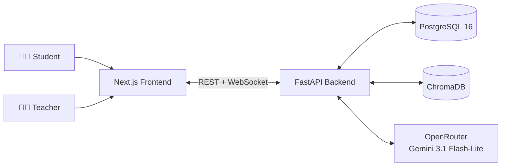
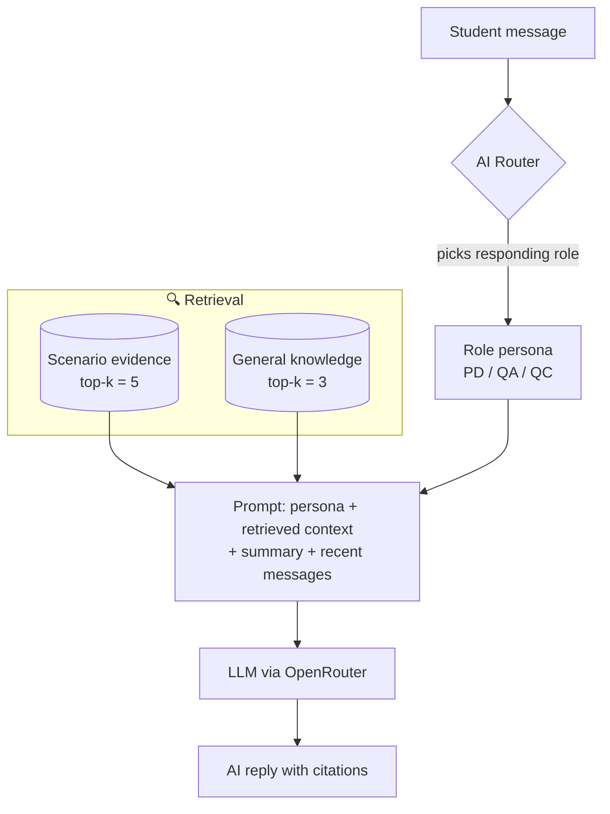
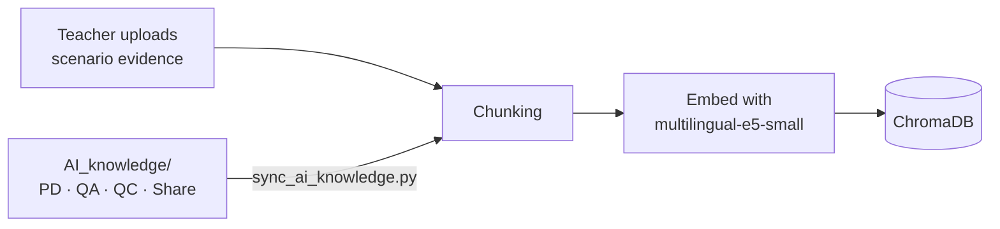

# 💊 Pharma CAPA Simulator

> An AI-powered role-play simulator that lets pharmacy students practice **CAPA (Corrective and Preventive Action)** meetings, with AI agents playing the other members of the team.

Built for the **Faculty of Pharmacy, Chiang Mai University** · Piloted with faculty and students in **October 2026**

<!-- TODO: add a screenshot or GIF of a meeting session here -->
<!--  -->

---

## 📖 Overview

In the pharmaceutical industry, a CAPA meeting brings together **Production (PD)**, **Quality Assurance (QA)** and **Quality Control (QC)** to investigate a quality problem, find its root cause and agree on corrective and preventive actions. These meetings are hard to practice in a classroom because each student needs a full team to play against.

With Pharma CAPA Simulator:

1. **Teachers** create CAPA scenarios, attach evidence documents (batch records, deviation reports and so on) and define a grading rubric.
2. **Students** pick a scenario and **choose one role**: PD, QA or QC.
3. **AI agents play the other roles** in a live meeting, answering from the scenario evidence and their department's domain knowledge.
4. Students draft the **CAPA form**, which is **graded against the teacher's rubric**, and teachers review and give feedback.

## ✨ Features

### For students
- 🎭 **Role selection**: play PD, QA or QC; the remaining roles are filled by AI personas
- 💬 **Real-time meetings** over WebSocket, with typing indicators
- 🔗 **Cited answers**: AI replies point back to the evidence documents they used
- 📝 **CAPA form drafting**: content is extracted from the meeting into a CAPA form that can be exported as a Word report
- 📊 **Grading and feedback**: AI grading against the teacher's rubric, plus written feedback from teachers
- 🕘 **History** of past meetings and results

### For teachers
- 📚 **Scenario library**: create and edit CAPA scenarios
- 📎 **Evidence documents**: upload and edit the documents attached to each scenario
- ✅ **Rubrics**: define how student work is scored
- 🧑‍🏫 **Review**: read meetings, adjust scores and leave comments

### AI pipeline
- 🧭 **AI router**: decides which AI role should respond to each message
- 🧑‍🔬 **Role personas**: each role has its own system prompt (`PD.txt`, `QA.txt`, `QC.txt`)
- 🔍 **Two-layer RAG**:
  - **Scenario evidence**: documents attached to the current scenario
  - **General knowledge base**: shared domain references organized by role (`PD`, `QA`, `QC`, `Share`)
- 🧾 **Summarizer**: compresses older messages so long meetings stay within the model's context
- 🛡️ **Guardrails and limits**: response retries, per-student session limits, turn rate limits, timeouts and a monthly LLM spend cap

### Platform
- 🔐 **Authentication** restricted to `@cmu.ac.th` emails, with student and teacher roles and email OTP verification
- 🔒 **Privacy notice** that users must accept before using the system

## 🏗️ Architecture



### Meeting turn flow



### Document ingestion



| Setting | Scenario evidence | General knowledge |
|---|---|---|
| Chunk size | 1,000 | 1,200 |
| Chunk overlap | 150 | 180 |
| Top-k retrieved | 5 | 3 |

## 🛠️ Tech Stack

| Layer | Technology |
|---|---|
| Frontend | Next.js, TypeScript |
| Backend | FastAPI (Python), WebSocket, [uv](https://github.com/astral-sh/uv) |
| Database | PostgreSQL 16, Alembic migrations |
| Vector database | ChromaDB (embedded) |
| Embedding model | [`intfloat/multilingual-e5-small`](https://huggingface.co/intfloat/multilingual-e5-small) |
| LLM | `google/gemini-3.1-flash-lite` via [OpenRouter](https://openrouter.ai) (router, personas and summarizer) |
| Auth | JWT, email OTP; Microsoft Entra External ID / AWS Cognito supported |
| Testing | pytest, Vitest, Playwright |
| Infrastructure | Docker Compose, Caddy, AWS (S3, CloudFront, CloudWatch), Sentry |

## 📁 Project Structure

```
.
├── AI_knowledge/          # General knowledge base (PD / QA / QC / Share markdown)
├── backend/
│   ├── alembic/           # Database migrations
│   ├── app/
│   │   ├── adapters/      # External integrations (OpenRouter, email, Entra, ...)
│   │   ├── core/          # Config, database, security
│   │   ├── models/        # SQLAlchemy models
│   │   ├── modules/       # Business logic (chat, router, RAG, grading, ...)
│   │   └── routers/       # API endpoints
│   ├── prompts/           # System prompts for router, personas, grading, summarizer
│   ├── scripts/           # Knowledge sync, user management, deployment checks
│   └── tests/
├── frontend/
│   ├── e2e/               # Playwright tests
│   └── src/
│       ├── app/           # Next.js pages (chat, scenario-library, dashboard, ...)
│       ├── components/
│       └── lib/
├── docs/                  # Local development and project structure guides
├── infra/                 # Production configuration
└── compose.yaml
```

## 🚀 Getting Started

See [`docs/LOCAL_DEVELOPMENT.md`](docs/LOCAL_DEVELOPMENT.md) for the full guide.

### Prerequisites

- Docker and Docker Compose
- An [OpenRouter](https://openrouter.ai) API key

### Run with Docker Compose

```bash
git clone https://github.com/MaMuangHub/pharma-capa-simulator.git
cd pharma-capa-simulator

# Create the backend environment file and fill in the values (never commit real keys)
cp .env.example backend/.env   # TODO: confirm the location of .env.example

docker compose up --build
```

- Frontend: http://localhost:3000
- Backend API: http://localhost:8000/api/v1

In local development, OTP codes are written to the backend log instead of being emailed:

```bash
docker compose logs backend | grep auth.otp_code
```

### Key environment variables

| Variable | Description |
|---|---|
| `DATABASE_URL` | PostgreSQL connection string |
| `JWT_SECRET_KEY` | Secret for signing access tokens |
| `OPENROUTER_API_KEY` | API key for OpenRouter |
| `CAPA_ROUTER_MODEL` / `CAPA_PERSONA_MODEL` / `CAPA_SUMMARIZER_MODEL` | Models used for each AI task |
| `EMBEDDING_MODEL` | Embedding model for RAG |
| `CHROMA_PERSIST_DIRECTORY` | Where ChromaDB stores its data |
| `AI_KNOWLEDGE_SOURCE_PATH` | Source of the general knowledge base (local path or `s3://`) |
| `AUTH_ALLOWED_EMAIL_DOMAINS` | Email domains allowed to sign in |

### Sync the general knowledge base

```bash
cd backend
uv run python scripts/sync_ai_knowledge.py
```

### Run tests

```bash
cd backend && uv run pytest
cd frontend && npm test
```

## 🗄️ Database Design

The PostgreSQL schema covers users, scenarios and their documents, meetings (chats and messages), AI routing decisions, CAPA forms and plans, rubrics, feedback and email verification. Changes are managed with Alembic migrations.

<!-- TODO: add an ER diagram image or a mermaid erDiagram of the real tables -->
<!--  -->

## 👥 Team & Contributions

<!-- TODO: add teammates' names and roles -->

| Member | Responsibilities |
|---|---|
| **Thanaphat Penphaen** ([@thanaphat123](https://github.com/thanaphat123)) | • **Database design**: PostgreSQL schema (tables, data formats and storage)<br>• **Scenario knowledge storage**: storing scenario knowledge uploaded by teachers<br>• **RAG pipeline**: chunking, embedding with multilingual-e5-small into ChromaDB, and simple RAG so each AI role answers students from scenario evidence<br>• **AI grading**: scoring the conversation and giving students feedback when a meeting ends<br>• **AI CAPA report**: filling in the CAPA report form from the meeting for students to download and submit |
| _Teammate_ | _Role_ |

## 🧪 Pilot

The system was opened for testing by teachers and students of the Faculty of Pharmacy, Chiang Mai University in **October 2026**. Teachers reported that it met the core requirements of the course. Improving the frontend design is planned as a next step.

## 🙏 Acknowledgements

- Faculty of Pharmacy, Chiang Mai University, for the project requirements and domain expertise
