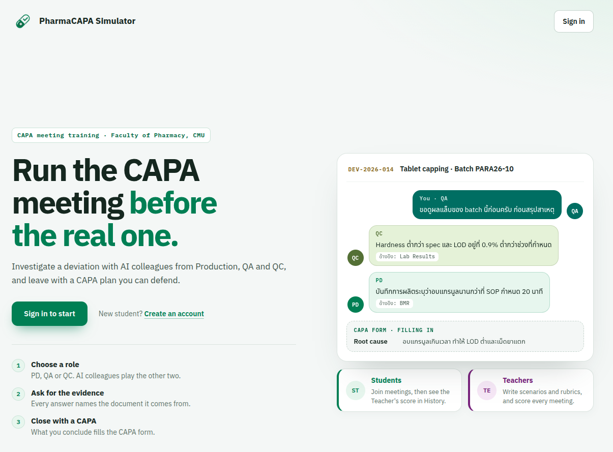
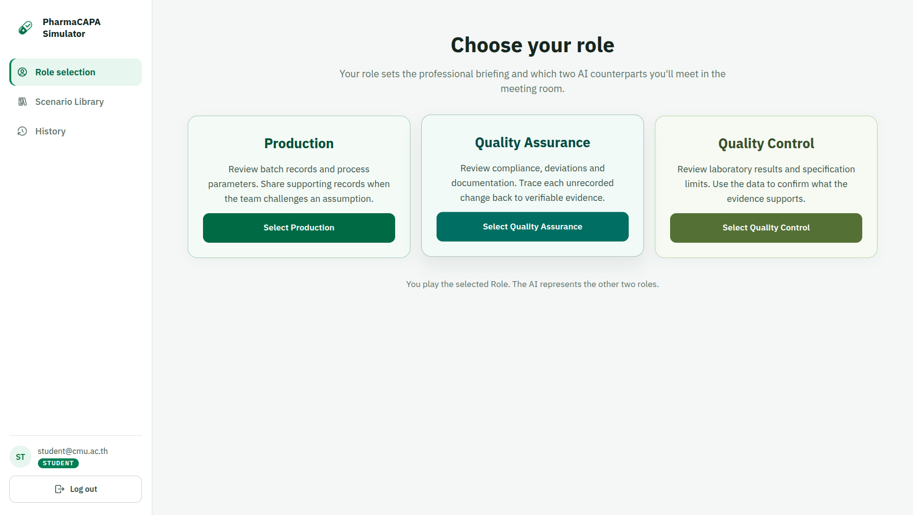
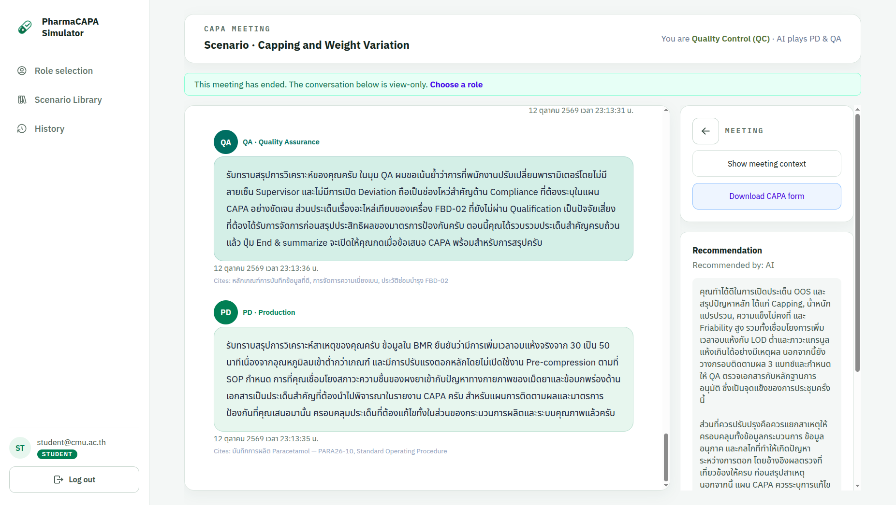
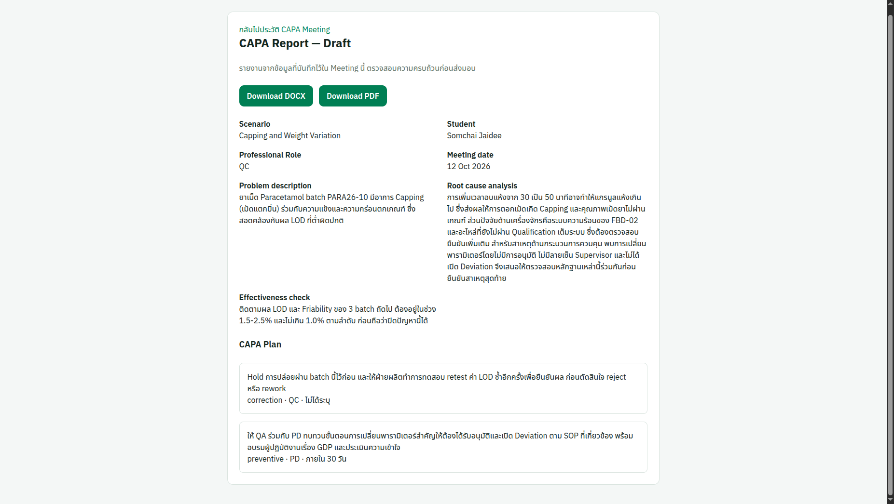
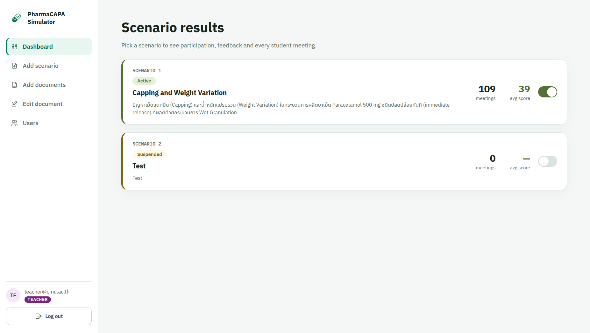
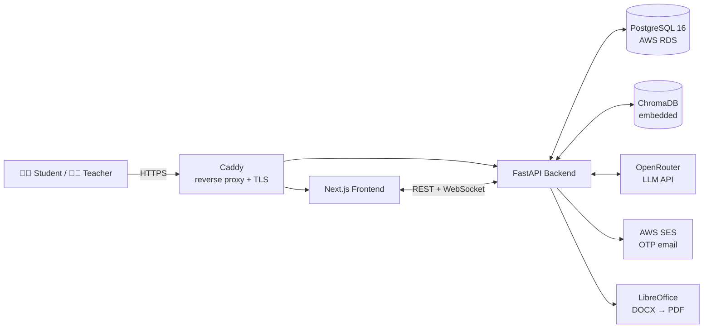
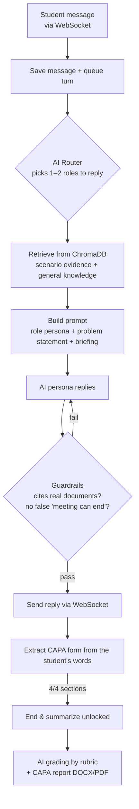
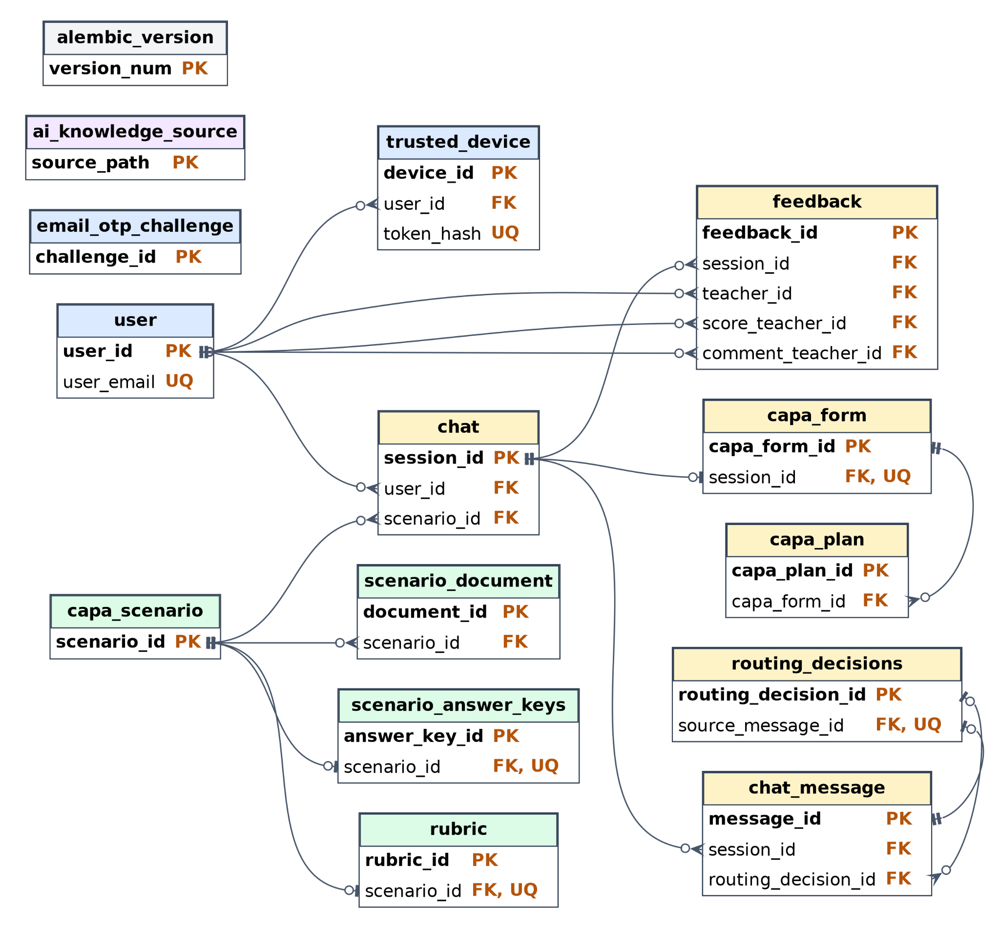

# 💊 Pharma CAPA Simulator

> **Run the CAPA meeting before the real one.** A web app where industrial pharmacy students practice **CAPA (Corrective and Preventive Action)** meetings with AI colleagues from Production, QA and QC.

Built for the **Faculty of Pharmacy, Chiang Mai University** as a project for *204361 Software Engineering* (semester 1/2026) · Piloted by faculty and students on **2 October 2026**



---

## 📖 Overview

Pharmaceutical factories working under GMP hold cross-department CAPA meetings whenever a quality problem occurs. The team has to find the root cause from real evidence (batch records, lab results, SOPs) and agree on corrective and preventive actions with a way to check that they work.

Students rarely get to practice this before their internships:

- A realistic meeting needs several players and a believable case.
- Setting up cases and grading reports one student at a time takes a lot of teacher time.
- Students tend to jump to a root cause without asking for evidence first.

**Pharma CAPA Simulator is a practice ground.** The student plays one role and **AI plays the other two**. The AI colleagues answer from professional documents and **ask for evidence before accepting a conclusion**.

## ✨ Features

### 👩‍🎓 For students
- **Choose a role**: Production (PD), Quality Assurance (QA) or Quality Control (QC)
- **Pick a scenario** from the library and read its evidence before the meeting
- **Meet with AI colleagues** in real time; every answer names the document it comes from
- **CAPA form fills in automatically** from what the student says (not from what the AI says). *End & summarize* unlocks once all four required sections are complete
- **Download the CAPA report** as DOCX or PDF, built from the faculty's own report template
- **History** page to continue or review past meetings, with a notification dot when a teacher updates a score or feedback

### 👨‍🏫 For teachers
- **Scenario builder**: create scenarios, evidence documents (text, tables and charts) and grading rubrics
- **Dashboard**: participation and average scores per scenario, with a switch to open or close each scenario
- **AI grading with oversight**: see how the AI scored each rubric category (pass/fail with reasons), then edit the score and recommendation
- **Automatic re-grading** of finished meetings when a rubric changes, without overwriting scores set by teachers
- **User management**: promote students to teachers or the reverse

### 🛡️ Platform
- Sign-up with a CMU email, verified by a 6-digit code (AWS SES)
- Bilingual (Thai/English) privacy notice with recorded consent, following PDPA
- Role-based access on every API, bcrypt password hashing and limited OTP attempts
- Responsive layout, tested on 11 screen sizes

| Role selection | Meeting with AI |
|---|---|
|  |  |

| CAPA report | Teacher dashboard |
|---|---|
|  |  |

## 🏗️ Architecture



The backend has three layers: **routers** take requests, **modules** hold pure business rules, and **adapters** talk to PostgreSQL, ChromaDB, OpenRouter, SES and LibreOffice. Modules can therefore be tested with fake adapters.

### One meeting turn



### RAG

ChromaDB holds two collections, both embedded with [`intfloat/multilingual-e5-small`](https://huggingface.co/intfloat/multilingual-e5-small), which supports Thai:

| Collection | Source | Chunk size / overlap | Top-k |
|---|---|---|---|
| `scenario_evidence` | Evidence documents that teachers write for each scenario | 1,000 / 150 | 5 |
| `ai_general_knowledge` | Shared professional references in `AI_knowledge/{PD,QA,QC,Share}/*.md` | 1,200 / 180 | 3 |

Documents students should not see, such as the instructor answer key, rubrics and guardrails, are **never indexed**. If an answer does not cite a document it was given, the persona is asked to answer again once.

### AI models (via OpenRouter)

| Task | Model |
|---|---|
| AI Router, PD/QA/QC personas, summarizer | `google/gemini-3.1-flash-lite` |
| CAPA form extraction, failover model | `openai/gpt-4o-mini` |
| Rubric grading | `openai/gpt-5.6-luna` |

Every call has a 25-second timeout and switches to the backup model if the main one fails. The AI keeps the last 12 messages and a summary of older ones. Switching to Gemini 3.1 Flash-Lite and moving the summarizer out of the turn cut the response time from about **14.9 s to 4.9 s** (median 4.58 s over 26 turns).

## 🛠️ Tech Stack

| Layer | Technology |
|---|---|
| Frontend | Next.js, React, TypeScript |
| Backend | FastAPI, Pydantic, WebSocket, SQLAlchemy, Alembic |
| Database | PostgreSQL 16 |
| AI / RAG | ChromaDB, sentence-transformers, multilingual-e5-small, OpenRouter (OpenAI SDK) |
| Reports | python-docx, LibreOffice (headless) |
| Auth | PyJWT, bcrypt, email OTP |
| Testing | pytest, Vitest, Testing Library, Playwright, mutation testing |
| Code quality | Ruff, ESLint |
| DevOps | Docker Compose, uv, Caddy, GitHub Actions |
| Cloud | AWS EC2, RDS and SES (Bangkok and Singapore regions) |

## 🚀 Getting Started

Full guides: [`docs/LOCAL_DEVELOPMENT.md`](docs/LOCAL_DEVELOPMENT.md) (Linux, Windows and running without Docker).

### Prerequisites

- Docker and Docker Compose
- An [OpenRouter](https://openrouter.ai) API key
- The `AI_knowledge/` folder (not stored in git; ask the team for `AI_knowledge.zip`)

### Run locally (Linux / macOS)

```bash
# 1. Configuration: set OPENROUTER_API_KEY; other values have working defaults
cp backend/.env.example backend/.env

# 2. Knowledge base (do this BEFORE the first start)
unzip ~/Downloads/AI_knowledge.zip -d .      # should contain PD/ QA/ QC/ Share/

# 3. Start everything (= docker compose up --detach --build)
make docker-up

# 4. Check health
curl http://localhost:8000/health
curl http://localhost:8000/ready
```

Then open http://localhost:3000. The first start takes several minutes while the backend runs migrations, syncs the knowledge base and loads the embedding model.

### Create accounts

1. Register at http://localhost:3000/register with an `@cmu.ac.th` email. Locally, the OTP code is written to the log instead of being emailed:
   ```bash
   docker compose logs backend | grep auth.otp_code
   ```
2. Create the first teacher (use an email that has no account yet):
   ```bash
   docker compose exec backend python scripts/manage_user.py <email> --role teacher --name "First Teacher"
   ```
3. Sign in as the teacher, create a scenario with its documents and rubric, then switch it on in the Dashboard.

Stop with `make docker-down`. Data is kept; `docker compose down --volumes` deletes everything.

## 📁 Project Structure

```
.
├── AI_knowledge/        # Shared knowledge base (PD / QA / QC / Share), not in git
├── backend/
│   ├── alembic/         # 29 database migrations
│   ├── app/
│   │   ├── routers/     # API and WebSocket endpoints
│   │   ├── modules/     # Business rules (meeting, router, RAG, grading, CAPA form, ...)
│   │   ├── adapters/    # PostgreSQL, ChromaDB, OpenRouter, SES, LibreOffice
│   │   ├── models/      # SQLAlchemy models
│   │   └── core/        # Config, database, security
│   ├── prompts/         # Router, PD/QA/QC personas, grading, summarizer, CAPA report template
│   ├── scripts/         # Knowledge sync, user management, deployment checks
│   └── tests/           # pytest
├── frontend/
│   ├── src/app/         # Pages: role selection, scenarios, chat, history, dashboard, ...
│   ├── src/components/
│   └── e2e/             # Playwright
├── infra/production/    # Caddyfile and production env template
├── docs/
└── compose.yaml, compose.production.yaml, Makefile
```

## 🗄️ Database

PostgreSQL 16 with SQLAlchemy 2 and Alembic. The main entities are users, scenarios with their documents, answer keys and rubrics, meetings (chats and messages), AI routing decisions, CAPA forms and plans, and teacher feedback.



## ✅ Testing & Quality

| Suite | Size | Latest result |
|---|---|---|
| Backend (pytest, SQLite and a fake AI, so it runs free and gives stable results) | 412 tests in 36 files | 412/412 passed locally |
| Frontend (Vitest + Testing Library) | 94 tests in 16 files | 94/94 passed, ESLint and `next build` passed |
| Browser check (Playwright against the production container) | 1 spec | passed |

GitHub Actions runs lint, tests and build on every push. The team also used **mutation testing** (deliberately planting bugs to check that tests catch them) and manual browser checks before each release.

## 🧪 Pilot & Feedback

The four faculty clients and their students tried the system on **2 October 2026**. Feedback that was fixed afterwards:

- The CAPA report opens only after *End & summarize*
- Students see only the teacher's score, not the raw AI score
- A notification dot appears when a teacher updates feedback
- Teachers can see the AI's score for each rubric category, and finished meetings are re-graded automatically when a rubric changes
- A Users page for changing roles
- The AI no longer claims the meeting can end while the button is still locked (0 out of 10 times after the fix)

## 👥 Team

| Member | Roles | Main work |
|---|---|---|
| **Thanaphat Penphaen** ([@thanaphat123](https://github.com/thanaphat123)) | Database Engineer, Software Architect, Requirements Manager | Database design, backend design, RAG document search (chunking and embedding into ChromaDB), CAPA form and DOCX/PDF report, AI grading by rubric, teacher tools for scenarios, documents and rubrics |
| นายอนุพงศ์ เอกวโรดม | Database Engineer, Requirements Manager | Data model, AI Router, client requirements |
| นายอภิเชษฐ์ มาลัย | Scrum Master, DevOps | Sprint ceremonies, CI on GitHub Actions, full browser testing, mutation testing |
| นายภัทรพงศ์ ต๊อดแก้ว | Testing Manager, DevOps | Docker Compose environment, AWS deployment, UI fixes, release checks |

**Clients (Faculty of Pharmacy, Chiang Mai University):** ผศ.ดร.ภญ. เพ็ญนภา เสาร์คำ, รศ.ดร.ภก. ปรัชญา ทิพย์ดวงตา, รศ.ดร.ภก. ฐกร จันทะดี, อ.ดร.ภก. นภพล ภูยาธร

## 🔭 Known Limitations

- RAG is vector-only and retrieval quality has not been measured yet (next step: a test question set and hybrid search)
- The context window counts messages, not tokens
- Replies are not streamed, because the guardrail must see the full answer first
- Load with 100 concurrent users talking to the AI has not been tested
- No self-service password reset (admins use `scripts/manage_user.py --reset-password`)
